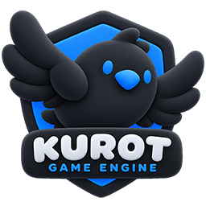

<p align="center">
  
</p>

<p align="center">
  <a href="README.md">English</a> · <a href="README.zh-CN.md">简体中文</a> · <strong>日本語</strong>
</p>

# Kurot

Kurot は、ブラウザーで動く 2D ゲームを TypeScript で開発するためのオープンソースエンジンです。

## 主な機能

- **描画：** スプライト、図形、テキストをツリー構造に組み合わせてシーンを作ります。WebGL では複数のテクスチャをまとめて描画し、WebGL が使えない環境では Canvas 2D に切り替わります。
- **アニメーション：** トゥイーン、MovieClip、パーティクルで動きを付けられます。DragonBones のスケルタルアニメーションにも対応しています。
- **ゲーム UI：** スキンを切り替えられるコンポーネントで HUD やメニューを作れます。[Kurot Editor](https://github.com/kurot-engine/kurot-editor-release) で編集した `.kui.xml` スキンは、CLI が ES モジュールにコンパイルします。

## 比較

| プロジェクト | 開発モデル | このベンチマークで使う描画バックエンド |
| --- | --- | --- |
| Kurot | 表示ツリー、スキン対応 UI、プロジェクト用 CLI を備えた 2D ゲームエンジン | WebGL 1・2 |
| [PixiJS 8](https://github.com/pixijs/pixijs) | コンテナとスプライトでシーンを組み立てる 2D 描画ライブラリ | WebGL 1・2 |
| [Egret 5.4.1](https://github.com/egret-labs/egret-core) | ディスプレイリストと EUI コンポーネントを使う HTML5 ゲームエンジン | WebGL 1 |

[ベンチマーク](packages/core/README.md#test-pages)では、スプライトのバッチ描画、オブジェクトの移動、テクスチャの切り替えなど、同じ 7 種類の処理を各エンジンで実行します。フレーム時間は同じ端末・ブラウザー・描画バックエンドで比較してください。3 者を比較する場合は WebGL 1 を選びます。

## クイックスタート

**Node.js 22.12.0 以降**（本プロジェクトでは Node 22.x を使用）と **pnpm** を用意します。エンジンのリポジトリをクローンせずにゲームを作成できます。

```sh
npx @kurot/cli@5 create my-game --template game
cd my-game
pnpm install
pnpm dev
```

開発サーバーが表示した URL をブラウザーで開き、`src/Main.ts` を編集してゲームを作ります。配布用にビルドするには `pnpm release` を実行してください。

[ゲーム開発ガイド](packages/core/docs/game-authoring.md) · [Star Catcher のサンプル](examples/star-catcher/README.md) · [API リファレンス](docs/api-documentation.md)
