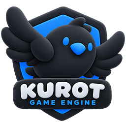

<p align="center">
  
</p>

<p align="center">
  <a href="README.md">English</a> · <strong>简体中文</strong> · <a href="README.ja.md">日本語</a>
</p>

# Kurot

Kurot 是一个开源的 TypeScript 2D 游戏引擎，用来制作可以在浏览器里运行的游戏。

## 引擎能力

- **渲染：** 用精灵、图形和文字构建显示树。Kurot 支持 WebGL 多纹理批处理；无法使用 WebGL 时会回退到 Canvas 2D。
- **动画：** 用补间动画、MovieClip 和粒子制作动效，也可以播放 DragonBones 骨骼动画。
- **游戏 UI：** 用可换肤组件制作 HUD 和菜单。在 [Kurot Editor](https://github.com/kurot-engine/kurot-editor-release) 中编辑 `.kui.xml` 皮肤，CLI 会将它们编译为 ES 模块。

## 对比

| 项目 | 开发方式 | 本仓库基准测试使用的后端 |
| --- | --- | --- |
| Kurot | 2D 游戏引擎，提供显示树、可换肤 UI 和项目 CLI | WebGL 1、2 |
| [PixiJS 8](https://github.com/pixijs/pixijs) | 2D 渲染库，用容器和精灵组织场景 | WebGL 1、2 |
| [Egret 5.4.1](https://github.com/egret-labs/egret-core) | HTML5 游戏引擎，使用显示列表和 EUI 组件 | WebGL 1 |

[基准测试](packages/core/README.md#test-pages)让三个项目运行相同的七种负载，包括精灵批处理、对象移动和纹理切换。比较帧耗时应使用同一台设备、同一浏览器和同一渲染后端；要同时对比三者，请选 WebGL 1。

## 快速开始

准备 **Node.js 22.12.0 或更高版本**（项目使用 Node 22.x）和 **pnpm**。无需克隆引擎仓库，即可创建游戏：

```sh
npx @kurot/cli@5 create my-game --template game
cd my-game
pnpm install
pnpm dev
```

打开开发服务器输出的网址，修改 `src/Main.ts` 就能开始编写游戏。运行 `pnpm release` 生成可部署的发布版本。

[游戏开发指南](packages/core/docs/game-authoring.md) · [Star Catcher 完整示例](examples/star-catcher/README.md) · [API 参考](docs/api-documentation.md)
